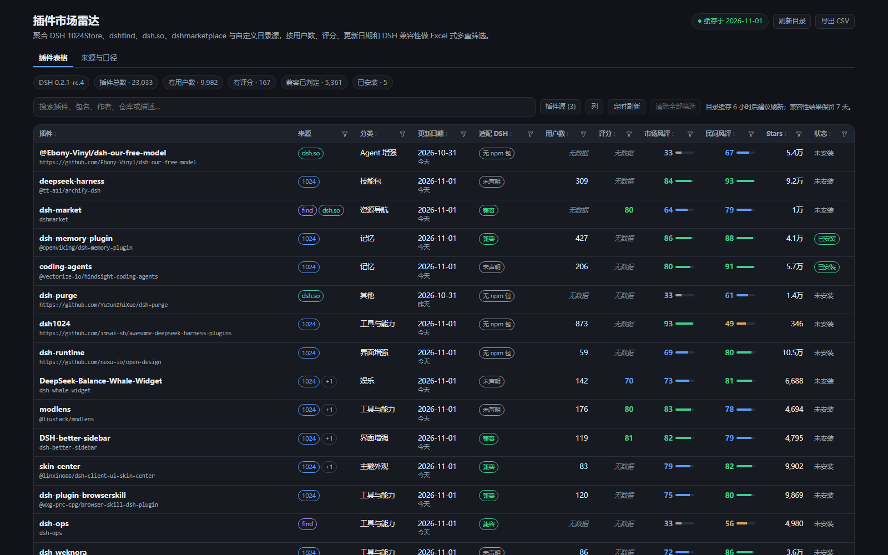
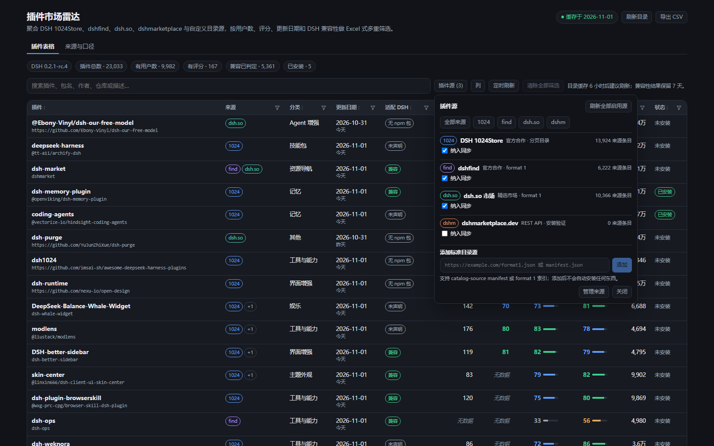
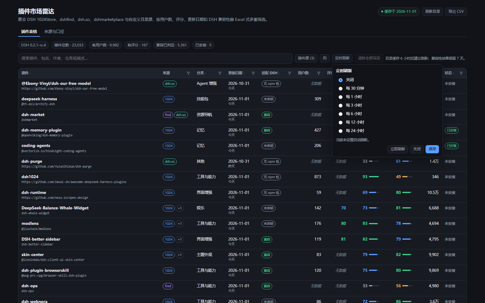
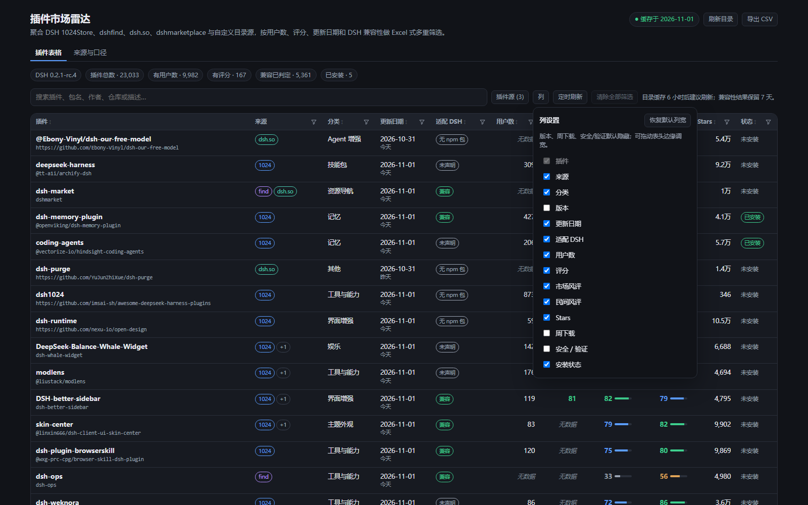

# DSH 插件市场雷达（@local/market-lens）

把多个 DSH 插件市场聚合成一张可像 Excel 一样筛选、可拖动列宽的表，并用 npm 元数据判断插件是否适配当前 DSH 运行时。



## 它解决什么

DSH 官方 Community Market 同一时刻只浏览一个目录源；社区里还有 dsh.so、dshmarketplace 等独立市场。各家的字段并不一致：

| 数据 | 1024Store | dshfind | dsh.so | dshmarketplace | 合并后 |
| --- | --- | --- | --- | --- | --- |
| 用户数 / 安装数 | ✅ `installerCount` | ❌ | ❌ | ❌ | 有就显示，没有显示“无数据” |
| 评分 | ❌ | ✅ 0–100（167 个） | ❌ | ❌ | 有就显示，没有显示“无数据” |
| 更新日期 | ✅ | ✅ | 版本发布时间 | ✅ 仓库推送 | 取较新值 |
| 版本 | ❌ | ✅ | ✅ | npm latest 补全 | 多源补全 |
| DSH 兼容性 | npm | npm | engines / npm | npm | 统一判定 |
| Stars | ✅ | ✅ | ✅ | ✅ | 取较大值 |
| 安装验证 / 安全 | ❌ | 标签 | ✅ L4/L5 + 审计低风险 | ✅ installCheck + riskFlags | 合并展示 + 筛选 |
| 周下载 | 部分 | ❌ | 部分 | ❌ | 有就显示 |

本插件按 **npm 包名** 与 **GitHub 仓库身份** 去重合并，保留每个字段的来源；缺失时明确显示 **“无数据”**，不补 0、不猜测。

## 与 DSH 内置市场的关系

DSH Desktop 已经内置了两个市场能力，先说清楚，避免重复造轮子的误会：

- **`dsh-community-market`** —— 插件市场面板本体，四个视图：**发现 / 可安装 / 已安装 / 来源**。它一次浏览一个来源，负责“看插件 + 装插件”。
- **`@deepseek-ai/dsh-plugin-market`** —— index URL 模型：一个索引 URL 定义一个来源，同一时刻只启用一个来源。

所以本插件**不是**再写一个市场面板，也不替代内置市场；它做的是内置市场刻意不做的那部分：

| 能力 | 内置市场 | 本插件 |
| --- | --- | --- |
| 浏览 / 安装单个插件 | ✅ 四视图 | ✅ 行内「装」一键安装（带降级重试与失败回执） |
| 同时看多个来源 | ❌ 单选来源 | ✅ 4 个内建源 + 任意标准源，合并去重 |
| 多列组合筛选 | ❌ | ✅ Excel 式：同列 OR / 跨列 AND，多选带计数，日期与数值区间可含“无数据” |
| 列宽拖动 / 列显隐 | ❌ | ✅ 表头拖动 + 列设置，持久化到 `localStorage` |
| 定时刷新 | ❌ | ✅ 30 分钟–24 小时 + `nextAutoRefreshAt` 排期，可取消 |
| 跨源去重与字段归属 | — | ✅ 按 npm 包名 / GitHub 仓库身份合并，保留每列来自哪个源 |
| 已装插件可更新检测 | ❌ 只显示“已安装” | ✅ 读官方 `pluginManager` 的已装版本，标出“可更新到 x.y.z”，详情给版本链 |
| 本次同步差异 | ❌ | ✅ 新增 / 更新 / 下架 badge，带“仅看本次变化”开关 |
| 安全优先视图 | — | ✅ 默认只显示已验证低风险条目，其余一键切回 |
| 来源配置迁移 | ❌ | ✅ 自定义源 / 启停 / 定时 / 安全视图导出成 JSON，换机或团队共享 |

一句话：**内置市场是“商店”，本插件是“比价表 + 直达安装”**。要按用户数、评分、更新时间、DSH 版本横切比较，导出 CSV，盯着“这周新上了哪些”，或者比较完直接点「装」，都用雷达。

## 0.8.0：安装后到底能不能加载 —— 三层装机体检

装插件最贵的问题从来不是「装不上」，而是**装上了但不出现**：点在面板上「装」，回执是绿的，重启后却没有设置页、没有面板、没有数据目录，dsh 的日志里一行都不提。0.8.0 把这条链路拆成三层，每层都查，结论一次说清。

### 第一层：挂载判定要认对包名

旧逻辑直接拿 `pluginManager.installBundle()` 返回的 `name` 去和 `dsh.profile.bundles` 比对。但管理器的返回值经常带版本号：

```
{ name: 'dsh-wechat-remote@1.7.15', bundle: 'dsh-wechat-remote', changed: true }
```

于是比对永远不相等，**明明挂上了却报「已装好，但没有挂载」**。真机日志里 `dsh-mp-automator` 那条就是这个形状：`packageName: 'dsh-mp-automator@0.3.0'` + `mounted: false`，而它其实在 bundles 里。

现在每个候选（`bundle` / `name` / `target` / `packageName` / `spec`）都先经 `packageNameFromSpec` 折成纯包名，折不出（`link:` / 本地路径）就跳过试下一个。另外，**只有声明了 `dsh.bundle` 的包才会被加进 bundles**；普通依赖永远不会出现，对它们报「没挂载」只会把人引到错误的页面。

### 第二层：插件自带的装载行能不能解析

bundle 进了列表还不够。真正决定「有没有面板」的是包自带 `cordis.patch.yml` 里那些 `- insert:` 行：

```yaml
- insert:
    - id: gate
      name: './native/index.js'
    - id: wechat-clawbot
      name: 'dsh-wechat-remote/clawbot'
```

**任何一条解析不到，宿主半身与浏览器半身会一起不挂**，而 dsh 照旧安静。判定口径照抄 loader，不自创：

- 相对路径行 → 按 patch 文件所在目录解析（loader 就是这么做的）
- 裸名 / scoped 名 → 先试包内自引用（`<自己包名>/subpath` 必须命中包自己的 `exports`），再试 profile
- 兜底用 loader 的 `packageDirFromAnchor` 口径：**只看目录里有没有 `package.json`**

最后这条很关键：`dsh-wechat-remote` 的 `exports` 里没有 `"."`，`require.resolve('dsh-wechat-remote')` 会报 `ERR_PACKAGE_PATH_NOT_EXPORTED`，但它的 bundle 挂得上。只按 `require.resolve` 判会把这类包全判成故障。

反过来，**子路径行**（`pkg/sub`）解析不到就是真的挂不上，不能拿「包目录在」蒙混过去——那是 `pkg@1.7` 删掉某个出口后最典型的失效形态。

### 第三层：peer 与输出结论

peer 判定与 `dsh-app-boot` 的 `unmetRequirements` 逐字一致：有 `engines.dsh` 就只看它，否则只看 `@deepseek-ai/dsh` 与 `@deepseek-ai/dsh-*` 前缀的 peer，且 range 是**与运行时版本**比较（这是 dsh 的独特约定）。

三层合起来给一个 `verdict`：

| verdict | 含义 | 界面 |
| --- | --- | --- |
| `ok` | 装好、挂好、装载行全通、peer 满足 | 绿色「安装完成」 |
| `warn` | 依赖写了但没进 bundles | 橙色「已装好，但没有挂载」 |
| `bad` | 装载行解析不到 / peer 冲突 | 橙色「装好了，但加载不了」，并把解析不到的行名直接列出来 |

`install.health` 会落进运行日志。注意传的是**扁平字符串数组**——`OpLog` 只保留标量与小数组，传 `[{status, name}]` 会被静默过滤成 `[]`，最关键的行名反而丢了（这是踩过的）。

### 顺手修掉：运行时版本恒为 null

`lib/runtime.js` 只找 `<asar>/node_modules/@deepseek-ai/dsh-app-boot/package.json`。当前的 desktop 布局是 `<asar>/dsh/node_modules/...`，于是 `runtimeVersion` 恒为 `null`，全表兼容性统统变成 `unknown`——这不是「查不出来」，是**查错了地方**。现在两种布局都试。

验证：`runtime: 0.2.1-rc.5`，来源标成 `app.asar:app-boot(dsh/node_modules/...)`。

---

## 0.7.0：规则库 + 下拉选择 + 可读的模版说明

0.6.0 的规则是「一个当前文件」，上传即覆盖。用久了就显出问题：想临时切回内置看看差距、再切回自己的那份，只能重新上传一遍；分享别人给你的规则，等于把自己的替换掉。

这一版把它改成一个**规则库**。

### 所有口径都进下拉框

规则页顶部现在是一个下拉框，候选项分三类：

| 来源 | 例子 | 能否删除 |
| --- | --- | --- |
| 内置 | 内置默认规则 | ❌ 只能切换 |
| 内置预设 | 默认（平衡）/ 扶持新插件 / 人气优先 | ❌ 只能切换 |
| 自己上传 | 你传上去的任何 JSON | ✅ 可删 |

选项文字自带来源标签和因子数（`只看新鲜度 · 自己上传 · 1 个因子`），不用逐条点开就知道选的是哪一类。选中即生效，切换不动库本身——上传过的东西一直都在，可以反复对比。

**上传不再覆盖**：每次上传都是往库里**加一条并启用**。同名会自动加序号（`只看新鲜度 (2)`），因为下拉框里两条一模一样的名字没法选。自定义规则上限 20 份。

**删除要二次确认**，且只有自己传的才有删除按钮。删掉正在用的那条会回退到内置默认，并在回执里说明。

**「恢复内置」不再删文件**——它只是把选择指回内置默认，你传的规则仍然留在库里，随时能选回来。

### 「这条规则在算什么」不再是 JSON

用户看得懂「`market.factors[0].weight = 0.55`」是没意义的。现在每组分数渲染成一栏：

```
市场风评  主排序分。表格「市场风评」列用的就是它。
[市场评分 · 原值截断 · 55%] [安装量 · 对数压缩 · 25%] [新鲜度 · 分档 · 10%] [编辑精选 · 10%]
仅当该指标存在时才用本组：市场评分
否则改用：来源覆盖
```

权重占比由 Host 在组内归一化后算好下发（`share`），前端只负责显示。没有因子的组会标成「这一组未参与评分」，避免用户以为配了却不生效。

### 模版说明改成了表格

原来的模版只有一段长 `readme` 文本。现在是三块结构化内容，点「规则说明」就地展开：

1. **指标表**：12 个 `metric` 值各一行——字段值 / 人话含义 / 用在哪
2. **归一化表**：10 个 `norm` 值各一行——同样的三列
3. **文件结构**：一份可直接抄的最小骨架，加「三组分数分别是什么」的说明

每张表下面都带一个具体例子（`log` 会把 100 和 1000 压到 50 分和 100 分）。

### 数据落在哪

- 规则库：`~/.dsh/market-lens/scoring-rules-library.json`（设备上只存用户自己的条目，内置与预设随包发布，不重复落盘）
- 回滚：删掉这个文件即回到内置默认；0.6.0 的单文件 `scoring-rules.json` 会在首次启动时被**自动迁进库里并设为当前**，迁完即删

实测（真实目录 25,691 行）：上传一份规则 479ms，下拉框切换 451ms，切回内置 628ms。

## 0.6.0：页面缓存 · 运行日志 · 可自定义评分规则

三件事，都是「用久了才会疼」的那种：

### 面板记住你看到哪儿了

翻到第十页、点进插件详情、切走再回来——以前又回到第 1 页、每页 100 条、默认排序，等于每次都要重翻一遍。

现在页签、页码、每页条数、搜索词、排序、表格滚动位置都写进 `localStorage`（`market-lens:page:v1`），重进面板原样恢复。

根因不只是在内存里：`setPage(1)` 的那个 effect 依赖数组里挂着自己，**首次挂载也会执行**，恢复出来的页码当场被打回 1。现在首次挂载直接跳过，只有用户真的改了搜索或排序才回第 1 页；每页条数也不再触发重置（底部分页控件自己会处理）。

快照坏掉（老版本删掉的排序列、越界的视图名）只退回默认值，不会把面板带崩。

### 运行日志：装不上时不用再猜

行内「装」失败以前只弹一条 8 秒就消失的 toast，内容还是被截短的 pnpm 报错。想再看一眼试的是哪个 spec、有没有降级，全都没了。

Host 侧现在有一个进程内环形缓冲（500 条），install / upgrade 全链路埋点：

```
install.request → install.unresolved / no-spec / no-manager / busy
                → install.attempt-failed → install.fallback
                → install.pending-builds / install.ok / install.failed（含异常栈前 4 行）
```

「运行日志」页签可以按级别、标签、全文搜，能一键复制或导出成 `.txt`（导出的就是能直接贴进 issue 的格式）。日志只在本次进程里，重启即清空——它服务的是「这次为什么没装上」这种当场要回答的问题，不是审计账本。

### 评分规则可以自己换

`marketScore / communityScore / heat` 的权重原先硬编码在 `lib/catalog.js`。不同来源数量级差好几个量级，固定权重对谁都不合适。

现在口径是一份纯声明式 JSON（`lib/rules.js`）：

- **指标白名单**：`rating` `users` `stars` `downloads` `forks` `installs` `failures` `freshness` `pick` `coverage` `sources` `enginesDsh`
- **归一化白名单**：`fixed` `coverage` `pick` `freshness` `log` `quantile` `linear` `percent` `power` `raw`
- 权重任意正数（`55` 和 `0.55` 等价，内部归一化）；写 `0` 表示「只看不参与」
- `when` 控制主组开门条件，关门时走 `fallback`
- `labels` 是分档阈值，必须 `excellent > good > fair`

「评分规则」页签支持：**下载模版**（自带全部指标/归一化清单与逐字段说明）→ 改 → **上传**；也可以**导出**当前规则分享给别人、套用**内置预设**（默认 / 扶持新插件 / 人气优先）、或一键**恢复内置**（会删掉规则文件，避免两套口径长期并存）。

规则文件落在 `~/.dsh/market-lens/scoring-rules.json`。外部输入一律先过 `normalizeRules` 收敛：未知指标、权重全 0、阈值不递减、因子超过 12 个都会被拒，并给出具体字段路径。

切换后不重新抓源也会立刻重算：实测 25691 行耗时 371ms。

内置模版在 `docs/scoring-rules.template.json`。

## 0.5.0：状态合并到按钮上 · 已安装页有真正的「更新」

这一版基本是在收拾 0.4.0 留下的自相矛盾：同一件事有两处显示、两个说法，或者按钮点了没反应。

**删掉「安装状态」这一列。** 原来表格里既有「状态」列（✅ / ✓ / 未安装）又有「操作」列（装 / 已装），两列说的是同一件事，而且状态列的文案还和按钮上的对不上（装完之后状态列立刻变，按钮却还写着「装」）。现在只剩一列 `actions`，状态直接长在按钮上：

| 行的情况 | 按钮长什么样 | 点它做什么 |
| --- | --- | --- |
| 目录里有新版 | `更新 ↑ 0.6.1`（带版本号） | `op: 'upgrade'`，装到该精确版本 |
| 已装、无新版 | `✓ 已装`（绿色；标题里带已装版本） | 重装 |
| 未装 | `装` | 安装（失败后变红字「重试」，错误留在标题上） |
| 算不出安装目标 | `手动` 灰字 | 打开两步指引 |
| 正在装/升级 | `…` | 禁用，标题显示在做哪件事 |

顺带把「安装状态」这套存储一起换掉，避免老值域把人坑了：

- 列可见性 key 升到 `market-lens:visibility:v3`，筛选 key 升到 `market-lens:filters:v2`（旧值里 `installed: ['yes']` 的 `yes/no` 和新列的 `update/installed/installable/manual` 对不上，读回来会变成一条**匹配不到任何行**的隐形筛选——列表莫名其妙空了，筛选栏上还看不出原因）。加载时另有一层 `sanitizeFilters()` 兜底，显式 `delete next.installed`。
- 筛选 chip 里那条 `已安装: yes` 也删了（它会为 `installed` 显示“否”，纯属说反），改由 `actions` 出 chip。

**已安装页补上真正的更新按钮。** 0.4.0 的已安装页只是把 profile 目录里存在的行列出来，**没有更新入口**：能看见“有新版本”这个事实，却没有任何地方能点。现在：

- 数据改由 Host 新增的 `installedPackages()` 提供（`status.installed.packages`），**不再只列目录里有的行**——本地 / `link:` / 私有包也能看见，页头的「已装 N」和表里的行数终于对得上。
- 每行一个 `更新` 按钮（`op: 'upgrade'` + 精确版本）；已是最新时按钮禁用并写「已是最新」；没有 registry 版本的包不给一个点了必然失败的按钮，操作列留 `—`，原因只在「最新版本」那列说一次（本地 `link:` 说「本地安装，没有 registry 版本」，`github:` / 仓库装的说明版本由 GitHub 决定——以前这两种都被写成“本地安装”，从仓库装来的包看起来像自己写的）。
- 页头有 `已装 N` / `可更新 N` 两个 chip、`刷新清单`、`检查更新`（带 `done/total` 进度）、按包名过滤的输入框、上次检查时间，以及失败提示条。

**「检查更新」点了没反应，修好了。** 两个原因叠在一起：

1. Host 侧 `updates.check` 返回的是 `running: false`，前端据此认为“没在跑”，于是不轮询，进度永远停在原地。
2. 就算在跑，判定只看了 `running`，而 Host 是**排队**执行的（`queued`），按钮会瞬间弹回可点状态，看着像没生效。

现在 Host 侧 `check()` 一开始就 `markQueued()`、结束清 `queued`，`status()` 里带 `queued` 字段，重复点击走 `queueUpdateCheck()` 不会并发；前端统一用 `running || queued` 判「检查中」，并加了一个 1.5 秒轮询，跑完自动重拉已装清单与目录。顺手修掉 `pending.length === 0` 时去读不存在的 `this.state.checked`、导致来源永远停在 `checking` 的那条。

**直接输入目标安装（自定义安装）原本必然失败。** 两处都错：前端把输入框内容硬塞成 `{pkg, repo}` 两个字段（`github:owner/repo` 这种写法怎么拆都不合法），而 Host 侧又是先判「目录里有没有这一行」再看 spec，于是只发 spec 的请求一律 404「目录里找不到该条目」。现在前端发 `{op: 'install', spec: target}`，Host 侧先把 spec 解析出来再决定要不要 404：`installSpecFor(row) → parseManualSpec(spec) → installSpecFromCommand()`，白名单是 npm 包名（可带版本）、`github:o/r`、`github:o/r#path:x`、`https://github.com/o/r`；解析不出来时回一句“支持这些写法”，而不是含糊的“找不到条目”。页面上原来吹的“装前判定”并没有实现，文案也一起改成实话。

**页签会整块白屏的两处空指针。** `CustomInstallPage` 与来源页的输入框状态被宿主复用成 `null` 之后，`null.trim()` 直接抛出，整个页签变成空白（控制台里只有一句 `Cannot read properties of null (reading 'trim')`）。现在统一过一层 `asText()` 折成字符串，`spec` / `url` / `customUrl` / `radarUrl` 全部按字符串处理；`InstalledPage` 的过滤框同样加了 `String(filter || '')`。另加了一条“五个页签依次打开、都不出现 `undefined/null/NaN/[object Object]`”的烟雾测试盯着这类回潮。

**导入配置每次都报「导入失败」，但其实已经导进去了。** `importConfig` 的回执表达式少了一个 `+`：`... + report.removed.length` 换行接 `(report.skipped.length ? …)` 被解析成“拿数字当函数调用”，每次都抛 `TypeError`，界面上就只剩一句“导入失败”。补上 `+` 之后回执正常（提示有多少条被跳过）。

**其它一起收拾的**：

- 工具栏那块常驻的缓存提示（`cacheHint`）删了；工具栏里重复的「导出配置 / 导入配置」也删了（设置页本来就有），隐藏的 `<input type=file>` 保留，设置页的导入照旧可用。表格页脚那句“数据来自: · 目录缓存 6 小时后建议刷新……”同样只在真的启用了源时才显示，且只显示源名——没源时不再渲染成一句“数据来自: . ”。
- 详情抽屉加「更新 ↑ x.y.z」按钮，复用同一条 `upgrade` 流程；「安装命令」区块里第二个把 `风险` 当标签用的重复行，改成 `风险标记`。
- 来源页里“添加标准目录源”的**表单渲染了两遍**（同一份 `h('section', …)` 复制粘贴），删掉一份。
- 设置页的 `transfer` 原来把 `{kind, text}` 原样 `JSON.stringify` 给用户看，现在按 kind 上色显示文本。
- `formatCompact` / `relativeDays` 在英文界面还吐中文（`万` / `昨天`），现在按 `lang` 输出 `K/M/B` 与 `today/yesterday/N days ago`。
- `formatNumber` 原来对非数字返回 `null`，拼进文案就成了字面量：`有用户数 · null`、`已安装 · null`。现在缺值统一显示 `—`。
- 已安装页的“升级中/升级失败”只认 `op: 'upgrade'` 的忙碌位（`actionBusy.mode === 'upgrade'`），在市场页装同一个包时不会误显示成“升级中”。
- i18n 里重复定义的键（`installedEmpty`、`downloads`、`allSources`）各留一份；删掉的 `installed` 列对应的文案不再被引用，`installedColUpdate` 也被 `installedColLatest` 取代（zh / en 342 键对齐）。

测试：`node --test tests/` 131 条全绿（其中一条断言跟着新按钮改成了 `^✓\s*(已装|Installed)$`——安装状态现在就在按钮上，这正是这一版要的；新增 `upgrade` 端到端 3 条、spec-only 安装 4 条、页签烟雾 1 条）。

## 0.4.0：真窗口手感 + 更新检查不再骚扰本地包

**弹层变成“像新建窗口”的样子。** 0.3.3 只是把弹层 portal 到 `document.body`，它仍然画在 DSH 的同一个文档里，看着还是“框在面板里”。0.4.0 把 `FloatingWindow` 做成桌面窗口的四件套：

- 标题栏一排控件：`–` 收起到标题栏（只剩 34px 高）、`□/❐` 最大化/还原（铺满整屏，留 8px 边距）、`⤢` 复位到默认大小、`⧉` 独立窗口、`×` 关闭。双击标题栏也能最大化；最大化状态下拖标题栏会先还原再跟着鼠标走。
- **八向缩放**：四边 + 四角都能拉，左边和上边是反向缩放（拉左边界时窗口左边跟手、右边界不动），拖到最小尺寸就钉住，不会缩成一条线。
- 多窗口叠放时点谁谁到最前（`zIndex` 递增），位置和尺寸仍按窗口 id 存在 `localStorage`（`market-lens:windows:v1`）。
- `⧉` 会试 `window.open('about:blank', 'market-lens:<id>', 'popup=yes,width=…')` 开一个真 OS 子窗口，用 `createPortal` 把 React 树渲染进它的 `document.body`，并把主文档的 `<style>`/`<link rel=stylesheet>` 克隆进子窗口 `<head>`，主题变量跟着走。**DSH 桌面壳子不给开新窗口**（`main.js:5278` 的 `setWindowOpenHandler` 一律 `return { action: 'deny' }`，只把 https/http/mailto 丢给系统浏览器），所以这条通道在桌面里会退化成“最大化到整屏”，并在窗口底部说明一句原因（`windowDetachBlocked`）；用浏览器跑 dsh web 时才是真窗口。传 `about:blank` 而不是空串是有原因的：经典构建的 handler 会 `new URL(url)`，空串直接抛 `TypeError`。

**更新检查不再打本地包。** 0.3.x 的 `UpdateService` 把 profile 里所有已装插件都丢给 `pluginManager.inspect`，包括 `link:` 装的本地插件和 `@local/*` 包。pnpm 对这些一律回 `invalid-spec` / `already-installed`，于是 `.plugin-manager/logs` 里堆满失败记录，官方插件页看上去就像“插件包异常”。现在：

- `isRegistryCandidate(pkg, spec)` 先过一道闸：`@local/*`、`link:`/`file:`/`portal:`/`workspace:`、`git+`/`github:`/`https:`/本地路径、`.tgz/.zip` 全部不查询，条目直接标 `source: 'skipped'`、`reason: 'local-package'`，且**不算错误、不写 warn**。
- `inspect` 回 `already-installed` 时按“没有更新”处理，不再当错误记一笔。
- 更新状态的口径（`sourceSummary`）不看被跳过的条目，不会因为本地包就把整体标成 mixed。

**一键自检。** 新增 `op: 'selfcheck'`：返回插件版本、运行时版本、profile 路径、缓存文件路径、源健康、兼容性与更新的统计。面板顶部的错误条也改成一行按钮：`重试` / `自检` / `复制错误`——以后再遇到“打不开”，先把这段贴出来就能定位，不用去日志里翻。

**面板整个不见了？先跑这一条。** 面板渲染不出来时，里面的按钮也点不到，所以自检还有一个不需要 DSH 的入口：

```powershell
cd "G:\AI PGRM\DSH\plugins\market-lens"
node scripts/selfcheck.mjs                 # 查默认 profile
node scripts/selfcheck.mjs --profile next  # 查 next 构建的 profile
node scripts/selfcheck.mjs --json          # 贴给别人看的原始快照
```

它会直接 import `index.js`、挂到假 `ctx` 上跑 `op: 'selfcheck'`，打印插件版本、路由是否注册、profile 路径、缓存行数、已装插件数、启用来源；退出码 1 表示存在“结构性问题”（例如路由没注册）。

排查顺序（按命中率）：

1. `slot entry crashed in 'main'` 出现在 `%USERPROFILE%\.dsh\logs\desktop-next.log` → 渲染端抛错，日志里那一行就是原因。
2. **插件的 bundle 条目被移出 profile**：`<profile>/package.json` 里 `dependencies` 有 `@local/market-lens`，但 `dsh.profile.bundles` 里没有它 → 依赖装了、却没被加载，面板直接消失（插件管理器里也不会报错）。补上 `"@local/market-lens"` 再重启即可；改这个文件前先备份，PowerShell 的 `ConvertTo-Json` 会写 BOM，需要再按 UTF-8 无 BOM 存回去，否则 pnpm 解析失败。
3. 目录缓存是空的（`market-lens\catalog.json` 不存在）→ 面板能开但没数据，点一次「刷新」。

## 0.3.5：安装失败要说话

以前安装失败只有两种结局：要么错误写进列表顶部的通用 `error`，被下一次 `status` 轮询的 `setError(null)` 抹掉（表现就是「点了没反应」）；要么藏在详情抽屉里，关掉就没了。0.3.5 把安装结果从通用错误里拆出来：

- **回执卡片**：结果贴在页头下方，红色（失败）/黄色（需要允许构建脚本）/绿色（成功）三种。失败卡片带 pnpm 原文、安装目标，以及「复制目标 / 复制错误详情 / 重试 / 去官方插件页安装」四个按钮；成功卡片 8 秒后自动收起，失败卡片留到用户自己关掉或下一次安装覆盖。轮询再也清不掉它。
- **降级重试**：目录里的版本号来自第三方市场，可能根本不在 npm 上（`ERR_PNPM_NO_MATCHING_VERSION`），GitHub 子目录也可能改名（`ERR_PNPM_INVALID_PATH`）。Host 现在会按报错把目标降一级——`pkg@x.y.z → pkg`、`github:o/r#path:x → github:o/r`——再试一次，并在响应里带 `fellBackFrom`，前端据此说明「装的是降级后的目标」。
- **构建脚本**：`pnpm` 拦下构建脚本时返回 `409 build-approval-required`，卡片变黄并给出「重试」，行内再点一次就会带上 `approvedBuilds`。
- **手动兜底**：算不出安装目标的条目不再只显示命令，详情里给「去官方插件页安装」，弹出两步指引（打开插件页 → 切「发现」→ 搜包名或粘贴目标），并附搜索词、包名、命令三个复制按钮。提取出的官方包里没有可用的页面跳转 API，所以这里是「复制 + 指引」，不是自动切标签页。

顺带删掉了详情里那句「仅展示与复制，不会自动执行。安装请使用 DSH 官方插件管理器或终端。」——它下面就是可以点的安装按钮，自相矛盾。

回归测试 `tests/client-install-notice.test.js` 用一套真跑 state 与 effect 的迷你 hook 运行时挂载面板：点行内「装」→ Host 返回 500 → 断言页面上出现「安装失败」和 pnpm 原文，再触发一次目录刷新（会 `setError(null)`）后断言回执还在；另外覆盖成功回执 + 行内变 ✓、以及无安装目标时的手动指引窗口。

## 0.3.4：修一次「面板打不开」

0.3.3 把 `installBusyKey` 的 `useState` 留在面板中段、却在更上面新加了一个 `useEffect`。effect 的**依赖数组是在渲染时求值的**，于是每次渲染都在 state 初始化之前读它：

```
ReferenceError: Cannot access 'installBusyKey' before initialization
slot entry crashed in 'main'
```

整个 `main` slot 当场崩掉，侧栏点进去是空白，控制台之外没有任何提示；`node --check` 和「模块能不能加载」的测试都发现不了，因为它是渲染期错误。现在三个安装相关的 state 统一提到组件顶部，并补了一条真挂载的回归测试（`tests/client-mount.test.js`）：用 stub hooks 实际调用 `PanelPage`，把这种 TDZ 挡在提交之前——反证脚本把它挪回去会立刻报同一条错。

## 0.3.3：浮动窗口 + 安装状态对齐

**弹层改成独立浮动窗口**。筛选、列设置、插件源、定时四个弹层现在通过 `react-dom` 的 `createPortal` 挂到 `document.body`，位置用 `position: fixed` + 最高层级，不再被 DSH 面板的 `overflow`/`transform` 裁剪或遮挡。窗口可以拖标题栏移动、拖右/下边缘或右下角改大小，双击标题栏复位；位置和尺寸按窗口 id 记在 `localStorage`（`market-lens:windows:v1`），下次打开还在原地。`react-dom` 不可用或 portal 抛错时退回行内渲染，功能不丢。

**行内「装」按钮修好**。根因是身份字段：Host 的 `publicRow` 只给 `id`（内部 key），前端却拿 `row.key` 比对，`undefined === undefined` 永远成立——于是点一次安装，整张表都被改成“已安装”，行内按钮也没有「…/✓」反馈，看起来像点了没反应。现在统一走 `rowKeyOf(row)`（`id → key → pkg → repo`），安装请求带真实 key，只更新命中的那一行，并回拉一次目录拿真实结果。

**安装状态实时同步**。`status` 现在带 `installed.fingerprint`（已装 `name@version` 集合的 sha1 前 16 位）与 `install.busy`：指纹一变前端就重拉目录，所以在官方插件市场、命令行里装/卸的插件，20 秒内（安装进行中 3 秒）会自己出现在表格里。安装成功后 `getInstalledPackages` 的 15 秒缓存立刻失效，不会出现“装完还是未安装、下一轮又全变”的抖动。

## 0.3.2：GitHub 子目录也能一键装

子目录条目以前被直接判成“没有可安装目标”，因为担心把仓库根装进来。现在按来源里的 `installCommand` / key 解析出子目录，折算成 pnpm 原生支持的 `github:owner/repo#path:packages/foo`：pnpm 会先校验该子目录真实存在，再安装它；不会退化成根仓库。来源数据过期、子目录已改名时 pnpm 会返回 `ERR_PNPM_INVALID_PATH`，错误会原样回到详情里，并提示刷新目录或打开仓库确认；界面不会再显示“需手动安装”的灰杠。

## 0.3.1：直接安装兜底

目录刷新后旧行可能从内存里消失；以前点「装」只带 key，Host 找不到行就回 404“请先刷新目录再安装”。现在前端随请求带当前行的安装快照，Host **目录优先、快照兜底**，目录里没有这一行也能直接装同一目标；不需要先刷新。快照仍做格式白名单校验，不执行任意命令。构建脚本被 pnpm 忽略时返回 `build-approval-required`，二次确认后才带 `approvedBuilds` 重试。

## 0.3.0：可更新检测 · 同步差异 · 安全视图 · 配置迁移

### 已安装插件的可更新检测

已装插件在表里额外带一个 `可更新 ↑ x.y.z` 徽标，详情抽屉里有完整的“版本差异”块。

- **已装版本**来自官方插件管理器：`pluginManager.listBundles()` 里 `installed !== false` 的 bundle。拿不到管理器时退回读 profile 的 `package.json` + `node_modules`。
- **最新版本**有两条通道，结果里标着来源：
  - `pluginManager.inspect(pkg)` —— 官方通道，走 `pnpm view`，尊重 profile 的 `.npmrc`、代理与私有 registry；结果按 `packageManager` 缓存，界面上写“官方”。
  - npm registry `latest` —— 兼容性检测里已经在拉的同一份数据，秒出；界面上写“npm”。
- 批量浏览先用缓存，**精查在后台跑**：工具栏“检查更新”触发 `updates.check`，进度显示 `done/total`，结果落 `updates.json`，TTL 30 分钟。
- 层级按 semver 划分：major / minor / patch，预发布单独标；主版本跨越在徽标和详情里都用警示色。
- **官方没有“列出全部已发布版本”的接口**。详情里的版本链是直接读 npm packument 的 `time` + `versions`（仅 npm 包），按时间倒序，标出 breaking（主版本变化）与预发布；没有 npm 包的行只显示“已装 → 最新”。
- 升级命令给的是精确版本：`dsh plugin add <pkg>@x.y.z`，不替你执行。

相关 op：`updates`、`updates.check`。

### 本次同步差异

每次刷新都会拿新目录和上一份快照对比，行上打 `新增` / `更新` / `下架` 徽标。

- 判据：同一主键（npm 包名或仓库身份）在上一份里不存在 → 新增；版本、更新日期、描述、来源集合任一变化 → 更新；上一份有、这次没有 → 下架。
- **首次同步不打标**（`baselined: true`）：没有上一份就没有“变化”，不给 23,000 行全上徽标。
- **这次没成功同步的来源不判下架**：某源 502 时把它的插件全标成“下架”是假信号，所以只对成功来源的条目判下架。
- 下架标记只活一代：上一代已经下架的行不再参与比较，避免“消失的行”无限累积。
- 工具栏“仅看本次变化”把筛选写成 `change ∈ {新增, 更新, 下架}`，和“清除筛选”共用一套逻辑；顶部汇总条给出 `+a / ~b / −c`。

### 安全优先视图

默认**只显示**能拿出正面证据的条目，其余藏起来并告诉你藏了多少条，一键“显示全部”切回。

放行条件（满足其一，且没有否决项）：

- dsh.so 的 `riskLevel === 'low'`；
- dshmarketplace 的 `installCheck === 'passed'`。

否决项压过正面结论：`riskLevel === 'high'`、`installCheck === 'failed'`、或 `riskFlags` 非空 → 一律不放行；`medium` 与“什么证据都没有”按未审计处理，同样隐藏。

开关存在 `source-config.json` 的 `safeView`（默认 `true`），不是浏览器本地状态——换台机器打开还是同一套口径。判定逻辑在 `lib/security.js`，Host 与面板共用同一份 `trustOf`。

### 来源配置导入 / 导出

工具栏“导出配置”下载 `market-lens-sources-<日期>.json`，“导入配置”读回来。格式：

```jsonc
{
  "format": "market-lens/sources",
  "formatVersion": 1,
  "exportedAt": "2026-01-01T00:00:00.000Z",
  "plugin": { "name": "@local/market-lens", "version": "0.3.0" },
  "settings": { "refreshIntervalMinutes": 180, "safeView": true },
  "sources": [
    { "id": "dshso", "kind": "dshso", "enabled": true, "builtin": true },
    { "id": "custom-…", "kind": "standard", "name": "团队源", "url": "https://…/manifest.json", "enabled": true }
  ]
}
```

- **导出不带健康状态**：上一台机器的 `lastError` / `failureCount` 对新环境没有意义，带过去只会制造“刚导入就报错”的假象。
- 导入默认 `merge`：同 id 更新、新 id 追加、文档里没有的源保持不动。`replace` 会删掉文档里没有的自定义源，但**内置源永远保留**（只能改启停）。
- 同一 URL 视为同一个源：导入时改配置而不是加一条重复源。
- 逐条校验，坏条目只跳过并写进回执，不整份失败：非 HTTPS、带凭据、非 443、kind 不在白名单、缺 `url`。
- 内置源的元数据（名称、颜色、端点）是代码契约，外部 JSON 只能改 `enabled`。
- 落盘失败整份回滚，返回 `ok: false` 与原因，不会留下“导入一半”的配置。

相关 op：`config.export`、`config.import`。

### 关于 dshbase.com（决定：不接 HTML）

dshbase 有 20,020 条，但只有 HTML 分页、没有稳定 JSON API。抓 HTML 意味着解析它的模板类名、分页结构和文案——对方改一次版式就静默坏掉，而且坏掉时看起来像“这个市场插件变少了”，不是像“解析失败”。

所以：**先不接**。添加 `dshbase.com` 的地址会在探测前被直接拦下并说明原因；导入的 JSON 里写着 `kind: "dshbase"` 也会被跳过并写进回执——两种情况给的都是同一句话：“等待官方 JSON API”。等它有 JSON 端点，走标准源契约（或一个专用 normalizer）就能接上，不需要动其它代码。


评估方法、证据、分数和未纳入来源见 [来源评估报告](docs/source-evaluation.md)。结论：

| 来源 | 市场风评 | 民间风评 | 角色 | 默认 |
| --- | ---: | ---: | --- | --- |
| **DSH 1024Store** | 92 | 78 | 官方内置合作源；用户数、安装热度、Stars、更新日期 | ✅ |
| **dshfind** | 88 | 82 | 官方内置合作源；评分、编辑推荐、npm 版本、Stars | ✅ |
| **dsh.so 市场** | 90 | 86 | 精选 format 1；只收 L4/L5 安装验证 + 低风险条目，附 Stars/榜单标签 | ✅ |
| **dshmarketplace.dev** | 84 | 80 | 公开 REST API；15,545 条，带 installCheck / riskFlags / 许可证 | ⬜ 可选 |
| **npm registry** | 95 | 60 | 元数据权威；版本与 DSH 兼容性判定，不作为发现列表 | ✅（元数据） |

- 1024Store 已在官方 Community Market 中注册并作为当前来源；dshfind 已注册但未启用，可在“来源与口径”页一键切换。
- dsh.so 精选市场：`https://cdn.dsh.so/market/index.json`（format 1，10,366 条）。
- dshmarketplace：`https://dshmarketplace.dev/api/v1/plugins`（REST，15,545 条，默认关闭以控制首次同步耗时）。
- 已评估但未内置：dshbase.com（20,020 条，HTML 分页、无稳定 JSON API）、dsh.so 全量索引（27,631 条，含未验证/高风险）、dshmarket 客户端（不是目录源）。详见评估报告。

### 四个内建源的端点

端点取自 `lib/catalog.js` 顶部的编译期常量（改源时以代码为准，不在文档里手改）：

| 来源 | 常量 | 端点 | 形态 | 抓取上限 |
| --- | --- | --- | --- | --- |
| 1024Store | `CATALOG_1024_ENDPOINT` | `https://deepseek1024.com/api/v2/plugins` | 自有 REST，`page` + `limit=200` | 最多 120 页（`MAX_1024_PAGES`） |
| dshfind | `CATALOG_DSHFIND_ENDPOINT` | `https://api.dshfind.com/market/dsh-index.json` | format 1 索引 | 一次全量 |
| dsh.so | `CATALOG_DSHSO_ENDPOINT` | `https://cdn.dsh.so/market/index.json` | format 1 索引 | 一次全量 |
| dshmarketplace | `CATALOG_DSHMARKETPLACE_ENDPOINT` | `https://dshmarketplace.dev/api/v1/plugins` | 公开 REST，`page` + `limit` | 实际约 96 条/页，约 162 页 |

内置源不可删除，只能停用；自定义源（format 1 或标准 manifest）可增删。

## 插件源管理

工具栏 **“插件源”** 打开一个来源列表：

- 勾选 **“纳入同步”** 决定雷达实际请求哪些市场；停用不会删除已缓存的行，下一次刷新后才会移除来源归属。
- 勾选来源名称按钮可以只显示这些来源的插件（同列 OR、与其他筛选 AND）。
- **添加标准目录源**：支持两种 URL：
  - **format 1** 索引（如 dsh.so 的 `market/index.json`）；
  - **catalog-source manifest**（`manifestVersion` + `transport.endpoint`，HTTPS、443、无凭据）；契约细节与可直接复制的示例见 [标准目录源契约](docs/standard-source.md)。
- 自定义来源可移除；内置来源只能停用。
- “管理来源”跳到“来源与口径”页，可看到每个来源的收录条目数、同步状态、错误和启停开关。



## 标准源契约（摘要）

“添加标准目录源”吃的是 **catalog-source manifest**：先取一个 manifest JSON，再按 `transport.endpoint` 去 `GET` 分页。完整契约、item 字段全集、可直接复制的最小 manifest / 最小 page 示例都在 **[标准目录源契约](docs/standard-source.md)**；这里只放速查表。

| 约束 | 值 |
| --- | --- |
| `manifestVersion` | 必须 `"1.0.0"` |
| `providerId` | `^[a-z0-9]+(?:[.-][a-z0-9]+)+$`（必须含 `.` 或 `-`，3–128 字符） |
| `homepage` / `attribution.url` | HTTPS，不带凭据，不带 fragment |
| `transport.kind` / `method` | 固定 `"https-json"` / `"GET"` |
| `transport.endpoint` | 必须匹配 `^https://…/v1/plugins$`：443、无 query、无 fragment、与 manifest 同源 |
| `query.supported` | ⊆ `q` / `category` / `capability` / `cursor` / `limit` / `sort` / `locale` |
| `query.sorts` | ⊆ `relevance` / `updated` / `name` / `downloads` |
| `defaultLimit` / `maxLimit` | 1–200 |
| 页面 `schemaVersion` | 必须 `"1.0.0"`，`items[]` 每页 ≤ 200 |
| `page.nextCursor` | 不透明游标；没有下一页时给空对象 `{}` |
| item 必填 | `id`、`name`、`displayName`、`summary`；`repository` 与 `package` 至少给一个 |

雷达的消费方式：`?limit=100` 翻页，最多 200 页 / 30,000 条，按 `package.name` 或 `repository.url` 去重进主键。契约里 `compatibility`、`capabilities`、`installSource.commit`、`keywords`、`media`、`license` 目前还没有对应的列，见下方建议清单。

安全语义：远端页面一律当**不可信输入**，provider 给的命令永不执行；只接受 HTTPS、不带凭据；跨源重定向一律拒绝，单次响应上限 24 MB。

## 定时刷新与手动刷新

- 工具栏 **“定时刷新”**：关闭 / 每 30 分钟 / 1 / 3 / 6 / 12 / 24 小时。
- Host 持久化设置到 `$DSH_HOME/market-lens/source-config.json`，并计算 `nextAutoRefreshAt`；到点自动同步，失败也会重新排期。
- 头部 **“刷新目录”** 随时手动刷新全部启用来源；同步中可取消。
- 首次同步或启用 dshmarketplace 后，建议点一次“刷新目录”。



## Excel 式筛选

每一列表头都有漏斗按钮：

- **多选**：来源、分类、适配状态、安全/验证、安装状态；同列 OR、跨列 AND，选项带动态计数。
- **日期**：近 7 / 30 / 90 天、今年、自定义起止；可包含“无数据”。
- **数值**：用户数、评分、市场风评、民间风评、Stars、周下载；可包含“无数据”。
- **文本**：版本（可选项）包含匹配。
- **筛选条件栏**：每个条件可单独移除，支持“清除全部筛选”。
- 全局搜索、表头排序、每页 50/100/200、导出带 BOM 的 CSV。

## 列宽与列显示

- **拖动表头边缘**即可调整列宽；列宽持久化到浏览器 `localStorage`。
- **列最小宽度压得很窄**（名称 96px，数值列 44–52px），因为表格动辄 14 列——列宽拖不下去时，其它列只能横向滚动。名称过长会省略显示，悬停看全文。
- **“列”** 打开列设置：
  - **版本默认隐藏**，需要时再显示；周下载、安全/验证也默认隐藏。
  - **精简 / 全部 / 默认** 三个预设，一键切换要显示哪些列（名称列永远保留）。
  - **恢复默认**同时重置列宽、列显隐和筛选栏开关。
- **筛选栏可关**：列设置里的「在表头显示筛选按钮」关掉后，表头只留排序，列压窄时表头文字才有地方显示；已生效的筛选仍显示在表格上方，不会变成隐形过滤。开关状态同样持久化。
- 默认列：插件、来源、分类、更新日期、适配 DSH、用户数、评分、市场风评、民间风评、Stars、安装 / 更新（末列按钮，安装状态就在按钮上，不再另设状态列）。
- 可选列：版本、周下载、安全/验证。



## 一键安装

详情抽屉里的**「安装到当前配置」**，以及**表格末列那个按钮**（行内直接点：`装` → `✓ 已装`，有新版本时直接变成 `更新 ↑ x.y.z`），都调用 DSH 官方插件管理器 `pluginManager.installBundle(spec, { enabled: true, saveExact: true })`，不需要复制命令再开终端。

- 「安装 / 更新」是独立窄列（默认 78px、min 56px、max 130px）：可拖动、可隐藏、精简预设里保留、恢复默认会还原，不干扰其它列的宽度与显隐。它的状态只有一处：按钮本身。
- 行内按钮 `stopPropagation`，点安装不会顺带打开详情抽屉；同一时刻只允许一个安装任务，其余按钮置灰为 `…`。
- **升级不是安装**：已装且有新版时走 `op: 'upgrade'`（`pkg` + 精确版本），目标版本必须真的比当前新——升不上去就算失败，不会把「升级」悄悄做成一次降级重装。本地 / `link:` 包不给升级入口（没有 registry 版本可比）。

- **不需要先刷新目录**。点「装」时前端把当前行的 `key / pkg / repo / version / installCommand` 一并发送；Host 先按 key、包名、仓库查当前目录，命中就用目录行；目录刚刷新导致这一行已经不在内存里时，用快照里的目标继续装同一行。
- 快照不是任意命令：只接受 npm 包名、`github:owner/repo`、`github:owner/repo#path:sub/dir`、GitHub 根仓库 URL；拒绝本地路径、空白和 shell 元字符。目录行优先，快照只在目录缺失时兜底。
  - 有 npm 包名 → `包名@版本`；只有稳定的精确版本才固定，范围/预发布交给 registry 解析 `latest`。
  - GitHub 仓库且无子目录 → `github:owner/repo`。
  - GitHub 仓库且来源带子目录 → `github:owner/repo#path:sub/dir`；pnpm 负责校验子目录是否存在，装错根仓库的路径不会出现。
- 官方插件管理器未加载（非 Desktop profile）时，接口返回 503 并说明原因，按钮不会给出“假成功”。
- 同一时刻只允许一个安装任务（pnpm 会改同一个 profile 的 manifest 与 lockfile，并发安装互相覆盖）。
- 如果 pnpm 因构建脚本被忽略而失败，Host 返回 409 `build-approval-required` 和具体包名；详情里点「允许构建并重试」，行内再点一次「装」即可带 `approvedBuilds` 重试。构建脚本不会被静默执行。
- 目录里的版本不在 npm 上、或 GitHub 子目录已改名时，Host 会自动降一级目标重试（`pkg@x.y.z → pkg`、`github:o/r#path:x → github:o/r`），并在响应里带 `fellBackFrom`；回执卡片会说明装的是降级后的目标。
- 安装失败一律出回执卡片（页头下方），带 pnpm 原文、「复制目标 / 复制错误详情 / 重试 / 去官方插件页安装」；轮询清不掉它。算不出安装目标的条目，详情里给「去官方插件页安装」的两步指引窗口。

## 字段口径

| 字段 | 口径 |
| --- | --- |
| 用户数 | 1024Store `installerCount`：去重安装实例数。只有通过 `dsh1024` CLI 安装才会计入，因此是**下限样本**。 |
| 评分 | dshfind 自有 0–100 评分，仅 167 个插件有；不是用户星级。 |
| 更新日期 | 1024Store `pushedAt`/`updatedAt`、dshfind/dsh.so 版本发布时间、dshmarketplace `pushedAt` 的较新值。 |
| 适配 DSH | npm latest 的 `engines.dsh` 优先；否则所有 `@deepseek-ai/dsh` / `@deepseek-ai/dsh-*` peer 对运行时做 semver 判定（含预发布，`workspace:` 按运行时处理）。 |
| 安全/验证 | dsh.so 安全审计等级与安装验证；dshmarketplace `installCheck` 与 `riskFlags`；其他来源没有时不显示。 |
| 市场风评 | 本插件计算的 0–100 指数：官方评分、用户数、新鲜度、编辑推荐/覆盖度加权。不是官方评级。 |
| 民间风评 | 本插件计算的 0–100 指数：Stars、周下载、新鲜度、Forks 加权；无 Stars 时为“无数据”。 |
| 无数据 | 来源确实没有该字段，表格、详情、CSV 都保留“无数据”。 |

兼容状态：**兼容 / 不兼容 / 未声明 / 无 npm 包 / 检测中 / 未知**；不兼容时详情列出未满足的 `engines.dsh` 或 peer 项。

## 字段可得性矩阵

“有这一列”不等于“每个源都填得出来”。下表说明每列的真实数据从哪来；拿不到就显示 **“无数据”**。

| 我们的列 | 标准 catalog 契约 | 1024Store v2 API |
| --- | --- | --- |
| 更新日期 | `updatedAt` | `updatedAt` / `pushedAt` |
| 适配 DSH 版本（列名“适配 DSH”） | `compatibility.apiVersion` + `hosts` | 无直接字段，需从 npm `engines` 推断 |
| 插件版本（列名“版本”） | `latestVersion` | 无 |
| 装机量（列名“用户数”） | **契约无此字段** | `installCount` / `installerCount` / `installs30d` |
| 评分 | **无** | **无**（只有 `stars` 星数） |
| 安装失败数（当前在详情） | 无 | `failureCount` |

三条硬规则：

1. **“评分”在任何来源都拿不到真实用户评分**：只有 dshfind 自有 0–100 运营评分，覆盖 167/6,222。没有就是没有——表格、详情、CSV 三处都写 **“无数据”，绝不补 0**，因为 0 分在排序里会把“没数据”压到最底，读起来像差评。
2. **“用户数”只在 1024Store 通道可得**（`installerCount`，且只统计 `dsh1024` CLI 安装，是下限样本）。标准契约、dshfind、dsh.so、dshmarketplace 都没有这个字段。
3. **“安装失败数”只有 1024Store 的 `failureCount`**，口径不透明，目前只放详情“失败计数（参考）”，不参与市场风评 / 民间风评计算，也还不是表格列。

其余来源：dshfind 给评分与 Stars、无用户数；dsh.so 给安装验证 L4/L5 与安全审计等级、无用户数/评分；dshmarketplace 给 `installCheck` / `riskFlags` / `pushedAt`、无版本/评分；npm registry 只给版本、`engines.dsh` 与 peer 依赖。

> 标准契约的 `compatibility.apiVersion` + `hosts` 是唯一“原生 DSH 版本声明”，雷达当前**尚未消费**它——标准源行的“适配 DSH”仍走 npm `engines` 判定。已列入建议清单第 7 条。

## 数据流与缓存

```text
1024Store /api/v2/plugins (70 页) ─┐
dshfind /market/dsh-index.json   ─┼─> 去重合并 -> 风评计算 -> catalog.json
dsh.so  /market/index.json       ─┤                         |
dshmarketplace /api/v1/plugins   ─┘                         +-> npm latest -> compat.json
```

- 目录缓存：`$DSH_HOME/market-lens/catalog.json`，建议 6 小时后刷新。上一份快照同时是“本次同步差异”的比对基线（`meta.diff`）。
- 兼容性缓存：`$DSH_HOME/market-lens/compat.json`，7 天有效。
- 可更新检测缓存：`$DSH_HOME/market-lens/updates.json`，30 分钟有效；官方 `inspect` 的结果按包名与 registry 记录。
- 来源与定时配置：`$DSH_HOME/market-lens/source-config.json`（含 `safeView`）。
- 同步在后台进行；目录先可用，兼容性结果以增量推送，不阻塞浏览。
- 网络失败保留旧缓存并显示来源错误；不会静默切换到另一个来源兜底。

## 官方市场联动

“来源与口径”页读取 DSH 内置 Community Market：

- 显示 1024Store / dshfind 是否已注册、是否为当前来源。
- 未注册的内置源可“添加到官方市场”（只添加，不启用）。
- 已注册未启用的源可“设为官方市场当前来源”（二次确认）。
- 支持直接向官方市场添加 standard manifest URL；与雷达自己的“插件源”分开管理。

## 安装与重启

本插件以本地 link 方式安装到 `desktop` profile：

```jsonc
// ~/.dsh/profiles/desktop/package.json
"dependencies": {
  "@local/market-lens": "link:G:/AI PGRM/DSH/plugins/market-lens"
},
"dsh": {
  "profile": {
    "bundles": [ /* ... */, "@local/market-lens" ]
  }
}
```

执行 `pnpm install` 后**重启 DSH Desktop**；当前窗口不会热加载新的 Host bundle。

## 隐私与安全

- Host 只允许 loopback POST，请求体上限 1 MB。
- 内置来源使用编译期固定 URL；自定义来源只接受 HTTPS、443、无凭据的 format 1 / manifest，且需要用户显式添加。
- 不执行插件命令、安装脚本或 shell；安装命令只展示/复制。
- 不采集账号、路径、会话内容；缓存只包含公开目录字段。

## 实测结果（2026-11-01）

- 合并 23,033 个插件；来源条目：1024Store 13,924、dshfind 6,222、dsh.so 10,366。
- 有用户数 9,982；有评分 167；有 Stars 21,678；有安全/验证结论 10,366；npm 包 8,806。
- 兼容性：3,544 兼容 / 1,817 不兼容 / 3,380 未声明 / 65 未知 / 14,227 无 npm 包 / 0 检测中。
- 真实 DSH 运行时验证：侧边栏“插件市场雷达”可加载，面板渲染 100 行/页；新版 Host 的 23,033 行缓存已用同一 `dsh web` 运行时加载验证。
- React/Playwright 验证：列宽拖动（112→144px）、版本列开关、来源管理弹层、定时刷新保存（30 分钟）、自定义来源添加/移除，均无 pageerror。
- 当前 desktop 窗口仍运行旧 Host；需要**重启 DSH Desktop** 才会加载多源/定时/列宽这版代码。
- 自定义来源实测：成功添加 format 1（dsh.so 榜单）与 standard manifest（dshfind manifest），并正常移除。

## 目录

- `index.js` — Host 路由、多源同步、来源/定时配置、缓存
- `lib/catalog.js` — 各源标准化、去重合并、风评计算、standard/format1 适配
- `lib/source-config.js` — 来源注册表与刷新计划持久化
- `lib/compat.js` — npm latest + DSH 兼容性判定
- `lib/updates.js` — 已装版本 → 最新版本：semver 层级、官方 `inspect` 精查、版本链
- `lib/sync-diff.js` — 两次快照的新增 / 更新 / 下架判定
- `lib/security.js` — 安全优先视图的放行与否决规则（Host 与面板共用）
- `lib/rules.js` — 评分规则引擎：指标/归一化白名单、校验、加权聚合、模版与预设
- `lib/op-log.js` — 进程内环形操作日志（安装排查用）
- `lib/runtime.js` — 运行时版本 / profile / asar 读取
- `client.js` — 浏览器面板、筛选、窗口层、来源/定时弹层、详情、日志页、规则页
- `scripts/selfcheck.mjs` — 不开 DSH 也能跑的结构自检（`node scripts/selfcheck.mjs --profile next`）
- `scripts/smoke-rules.mjs` — 拿真实目录跑一遍 rules/logs 全链路（`npm run smoke`）
- `sources.json` — 机读来源档案
- `docs/scoring-rules.template.json` — 评分规则模版（带字段说明，可直接改后上传）
- `docs/source-evaluation.md` — 来源评估报告（含字段可得性矩阵、标准源作为第五类通道的评估）
- `docs/standard-source.md` — 标准目录源契约：manifest / page / item 字段全集 + 可复制的最小示例

## 已知限制

- 1024Store 目录存在同仓库/同包重复；合并后仍有大量 GitHub-only 条目。
- 评分覆盖很低（167 个），这是 dshfind 的现状。
- 用户数是 1024Store 的安装统计口径，不是全量 DSH 用户。
- 兼容性基于 npm latest；目录快照中的旧版本可能不同。
- 可更新检测的“最新版本”只有两条来源：官方 `pluginManager.inspect`（一次一个包，走 `pnpm view`）与 npm registry `latest`。**官方没有“列出全部已发布版本”的接口**，所以版本链只对 npm 包可用，且读的是 packument 的历史版本与发布时间，不代表中间版本都经过验证。
- 安全优先视图的“安全”是**证据口径**，不是安全审计：只有 dsh.so 的 `riskLevel: low` 与 dshmarketplace 的 `installCheck: passed` 算正面证据；没有证据的条目被隐藏，不等于它有问题。
- dshmarketplace 默认关闭，首次启用全量同步需要额外时间；dshbase 不接（没有稳定 API，HTML 抓取一改版式就静默坏掉）。
- 官方市场同一时刻只能启用一个来源；雷达同时读多个源，不受限制。
- 标准源目前只消费 `id` / `name` / `displayName` / `summary` / `description` / `homepage` / `latestVersion` / `categories[0]` / `updatedAt` / `repository` / `package` / `publisher.name`；契约里的 `compatibility`、`capabilities`、`installSource.commit`、`keywords`、`media`、`license` 还没有对应列（`compatibility` 见建议清单第 7 条，`installSource.commit` 见第 11 条）。
- 自定义源只校验 scheme / 443 / 凭据与跨源跳转，尚未按解析后的 IP 段拦截私网地址（见建议清单第 9 条）。
- `⧉ 独立窗口` 靠 `window.open` 开真子窗口，但 **DSH 桌面壳子禁止新窗口**（主进程 `setWindowOpenHandler` 一律 deny，只把外链交给系统浏览器），所以在桌面里它会退化成“最大化到整屏”；浏览器里跑 dsh web 时才是真窗口。要真正的多窗口，得等外壳放开这条通道，或者宿主提供窗格 API。
- 更新检查只查 registry 上真正存在的包：`@local/*`、`link:`/`file:`/`portal:`/`workspace:`、git/路径/tarball 装的插件会标 `skipped`，永远显示“无更新”——它们的版本由你本地的工作树决定，问 npm 没有意义。
- 运行日志在进程内，**重启 DSH 即清空**，也不写任何磁盘文件。要看历史就得先导出。
- 评分规则只影响本插件算出来的 `marketScore` / `communityScore` / `heat`（以及默认排序），不改各来源自己给的原始 `score` 字段：后者是市场方的口径，改了就等于伪造数据。
- 页面缓存存在 `localStorage`，清浏览器站点数据会一起清掉；`localStorage` 不可用时（沙箱 webview）自动退回“不记忆”，功能不受影响。

## 额外利好建议清单（按价值/成本排序）

排序依据是**价值 ÷ 成本**。1–6 是低风险快赢（只动持久化与展示），7–9 需要小改数据流，10–12 是结构性改造。每条都落到了具体文件与字段，没有“优化体验”这种空话。基线是 2026-11-01 的代码状态：某条已经落地就以代码为准，不必按清单顺序补。

| # | 建议 | 价值 | 实现成本 |
| ---: | --- | --- | --- |
| 1 | 逐源健康度上屏（来源页徽标 + “N 个源待重试”） | `lastSuccessAt` / `failureCount` / `lastError` 已经落盘到 `source-config.json` 的 `sourceHealth`，但界面还只在设置面板里读；渲染成来源行徽标与顶部汇总，断源一眼可见，不用翻设置。 | `client.js` 复用现有 `sourceHealth`，来源页加 3 个单元格 + 顶部一条汇总，约 50 行，Host 不用改。 |
| 2 | 错过补偿（catch-up refresh） | 关机或休眠跨过排期时 `setTimeout` 不会补跑，缓存会停在几天前；启动时发现 `nextAutoRefreshAt` 已过期就立即补一次，才算真的“定时”。 | 启动 hook 里比较 `lastAutoRefreshAt` 与 `nextAutoRefreshAt`，命中则 `startSync({ trigger: 'catch-up' })`，约 20 行。 |
| 3 | `failureCount` 提为“安装失败”列 | 把“装不上”从详情里的参考数字变成可排序、可筛选的质量信号，能直接筛掉失败率高的插件。 | `normalize1024` 已经解析 `failures`，加一列 + 数值筛选 + “失败率 = failures / (installs + failures)”口径说明，约 60 行。 |
| 4 | 把已有 `heat` 升为可见的“综合热度”列 | 评分只覆盖 167 条，而 `attachScores` 已经算出 installers / stars / downloads 加权热度（目前只用于默认排序）；显式成列后，没评分的行也有可信的相对热度。 | 列定义加一项 + 详情展示权重构成，算法不动，约 30 行。 |
| 5 | CSV 导出带来源归属与快照元数据 | 现在导出的 CSV 无法复算；补 `sources` / `sourceIds` / `generatedAt` / 运行时版本，别人拿到表能验证每列出自哪个源、哪次抓取。 | 导出时追加 4 列 + 一行注释头，约 30 行。 |
| 6 | 源订阅一键导入 | 把“复制 URL → 打开插件源 → 粘贴 → 等探测”压成一次点击或一个 `?addSource=` 链接，社区分享的清单可以直接订阅。 | `sources.add` 已能自动探测，前端加导入入口 + URL 参数解析，约 50 行。 |
| 7 | 按 DSH 版本区间过滤（含“只看兼容当前运行时”） | 现在只有 6 个枚举状态，回答不了“1.2.x 能装哪些”；`compat.js` 已带 semver，加区间过滤即可。 | 一个区间输入 + 过滤谓词 + 状态栏计数，约 80 行。 |
| 8 | ✅ 已落地（0.3.0）：本次同步差异 | 定时刷新只保留“最新”，看不出“这周新上多少、下架多少”；现在用上一份目录当基线，行上直接打新增 / 更新 / 下架，还能一键只看变化。 | 已完成：`lib/sync-diff.js`（按 key 比较族 + 单代下架 + 来源失败不判下架）+ 行徽标 + “仅看本次变化”。保留 N 代历史仍未做。 |
| 9 | 私网 / SSRF 防护 | 当前只校验 scheme / 443 / 凭据，一个解析到 `127.0.0.1` 或 `169.254.169.254` 的域名会被放行；按解析后 IP 段拦截才算“防私网”。 | 请求前 `dns.lookup` 预检 + 拒绝环回 / 链路本地 / 内网段，manifest 与 page 两处都要过，约 60 行。 |
| 10 | 契约校验器（给标准源人话报错） | 社区源最常见的失败是 endpoint 写成 `/v1/plugins/`、`page.nextCursor` 给 `null`、item 缺 `summary`，现在统一报“page is invalid”，定位不到字段。 | 把 `docs/standard-source.md` §2–§6 的规则写成纯函数 + 字段级报错，约 100 行，可离线单测。 |
| 11 | 标准源安装固定到 commit | `installSource.commit` 是 40 位 sha，现在被忽略；用它生成 `github:owner/repo#<sha>` 安装命令，才能装到“目录当时验证过的那一版”。 | `normalizeStandardItem` 保留 `installSource`，安装命令拼接 sha，约 40 行。 |
| 12 | 源级缓存分片 | 现在任一源失败会让整轮 `startSync` 变红、只能整体重试；分片后每源独立成败与过期，dshmarketplace 的 162 页不必拖累首屏。 | 缓存从单文件改为 `sources/<id>.json` + 合并索引 + 旧缓存迁移，约 150 行。 |

## 0.6.0 的实测数据

在本机 `desktop` profile 的真实目录（25,691 行）上跑 `npm run smoke`：

| 操作 | 耗时 | 说明 |
| --- | --- | --- |
| `status`（含规则摘要 + 日志概况） | 69ms | 每 20 秒轮询一次，不能有额外开销 |
| `rules.set` 自定义规则（重算全表） | 371ms | 命令式重算，不需要重新抓源 |
| `catalog` 重拉（首屏） | 529ms | 25,691 行序列化 |
| `rules.reset` 恢复内置 | 521ms | 含删文件 + 重算 + 重写缓存 |

`scoring-rules.json` 557 字节，规则全文不进 `status`（只给指纹与摘要），所以 20 秒轮询不会重发几十 KB。

单元测试 196 项（`npm test`）：

| 文件 | 覆盖 |
| --- | --- |
| `tests/rules.test.js` | 默认规则与 0.5.0 硬编码口径逐字等价（手算期望值钉住）、外部输入收敛、各归一化行为、预设与模版 |
| `tests/op-log.test.js` | 环形容量、seq 单调、字段收敛、订阅不影响写入、导出格式 |
| `tests/host-rules.test.js` | 上传→立即生效→落盘→导出/导入往返→预设→恢复默认；坏文件退回内置并说明原因 |
| `tests/host-logs.test.js` | 安装失败留痕、按级别/标签/增量筛、导出文本、清空 |
| `tests/client-persist.test.js` | 重进停在原页、翻页持久化、改搜索回第 1 页、滚动恢复、坏快照退默认 |
| `tests/client-pages.test.js` | 日志页与规则页各按钮走对 op、Host 数据真的上屏、七个页签都能开 |

`client-persist.test.js` 里的迷你 React 是这一轮最费劲的部分：`useCallback` 必须按依赖缓存（否则 `loadCatalog` 每次都是新函数，boot effect 无限重跑）、hook 存储必须按组件模板隔离（否则子组件会按当前游标写进父组件的槽位）、`createElement` 必须把 children 也塞进 props（`client.js` 有些地方直接读 `props.children`）。这三处不照真 React 做，测出来的就全是测试替身的 bug。
